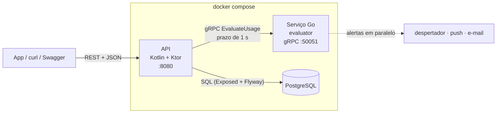

# no-scroll

Projeto da disciplina DIM0547 — Desenvolvimento de Sistemas Web II (UFRN, 2026.2).
Proposta: [docs/proposta.md](docs/proposta.md) · Quadro: [no-scroll — backlog](https://github.com/users/tobiasantos/projects/4) · Licença: [MIT](LICENSE)

## O que é

Muita gente perde horas rolando o feed de apps como TikTok e Instagram sem perceber. O celular já
mostra o tempo de uso e até permite limites, mas esses limites avisam uma vez e são ignorados com
um toque.

O no-scroll trata o limite como um despertador. Para cada app, o usuário define um limite diário e
como quer ser alertado: uma vez só ou periodicamente, até parar. O app do celular registra as
sessões de uso; a cada sessão, o sistema soma o uso do dia e, se o limite foi ultrapassado, dispara
o alerta em vários canais ao mesmo tempo (despertador, push e e-mail).

Este repositório é o **backend**: a API que guarda as regras e as sessões, e o serviço que avalia
o uso e alerta. O app mobile que mede o uso no aparelho fica para depois da disciplina.

## Arquitetura



- **API** (`api/`): CRUD de regras (`Setup`) e sessões (`Session`), paginação, filtros, validação,
  erros em *problem details* e OpenAPI. Ao registrar uma sessão, chama o serviço Go.
- **Serviço Go** (`services/`): recebe o uso do dia, calcula usados, restantes e excedido e, se
  excedeu, alerta nos três canais (simulados) ao mesmo tempo. Ver
  [ADR-0001](docs/decisoes/0001-servico-go-avaliador.md).
- **Contrato** (`protos/`): `noscroll.evaluator.v1`, validado com `buf lint`; os stubs são gerados.
- Se o serviço Go não responde dentro do prazo de 1 s, a API registra um aviso no log e grava a
  sessão do mesmo jeito (`201`).

## No ar

| | URL |
|---|---|
| API | https://no-scroll-api.onrender.com |
| Swagger (OpenAPI) | https://no-scroll-api.onrender.com/docs |
| Especificação | https://no-scroll-api.onrender.com/docs/documentation.yaml |

A API roda no Render (plano gratuito) a partir da imagem publicada pelo CI no GHCR, com o banco
gerenciado no Neon. O serviço Go não está no ar: no plano gratuito, gRPC entre serviços não é
possível, então ele roda junto da API no `docker compose`. Detalhes em
[ADR-0002](docs/decisoes/0002-implantacao.md).

O serviço gratuito dorme sem uso: a primeira requisição pode levar cerca de 1 minuto.

## Pré-requisitos

- [Docker](https://docs.docker.com/get-docker/) com Docker Compose v2 (Docker Desktop no Windows e no macOS)
- Para rodar os testes e as tasks: [mise](https://mise.jdx.dev), que instala as versões fixadas no
  `mise.toml` (JDK 25, Go 1.27, buf, grpcurl) com `mise install`

## Como rodar

```sh
git clone https://github.com/tobiasantos/no-scroll.git
cd no-scroll
docker compose up --build
```

Ao final, os três serviços ficam saudáveis (`docker compose ps` mostra `healthy`) e a API responde em
http://localhost:8080, com o Swagger em http://localhost:8080/docs. A API aplica as migrações ao
subir. A primeira execução demora alguns minutos, porque compila a API e o serviço Go.

Variáveis de ambiente (o `docker-compose.yml` já define todas, com valores de desenvolvimento):

| Variável | Exemplo | Para quê |
|---|---|---|
| `DB_URL` | `jdbc:postgresql://db:5432/noscroll` | Banco da API |
| `DB_USER` / `DB_PASSWORD` | `noscroll` / `noscroll` | Credenciais do banco |
| `EVALUATOR_ADDRESS` | `evaluator:50051` | Endereço gRPC do serviço Go |
| `PORT` | `8080` | Porta da API (padrão 8080) |

Para trocar as credenciais do banco local: `DB_USER=outro DB_PASSWORD=outra docker compose up --build`.
Para parar: `docker compose down` (com `-v`, apaga os dados).

## Como testar

Com o Docker aberto:

```sh
mise install
mise run test     # testes da API e do serviço Go
mise run lint     # go vet e buf lint
```

Ou separadamente: `cd api && ./gradlew test` e `cd services && go test ./...`.

| Suíte | O que cobre |
|---|---|
| API — `ValidationTest` | Regras de validação do domínio, sem banco nem HTTP |
| API — `RoutesTest` | Rotas com os repositórios em memória: status, `problem+json`, `400`/`404`/`422` |
| API — `SetupsTest`, `SessionsTest` | Integração com PostgreSQL real (Testcontainers): CRUD, relacionamento, paginação e filtros |
| API — `GrpcUsageEvaluatorTest` | A chamada ao Go contra um servidor gRPC em memória: resposta, prazo estourado e serviço fora do ar |
| API — `ArchitectureTest` | ArchUnit: o domínio não depende de Ktor, banco, gRPC nem dos adaptadores |
| Go — `evaluator` | Soma do uso, alerta só quando excede, canais em paralelo, prazo do `context`, entrada inválida |
| Go — `grpcapi` | O servidor gRPC: chamada completa, erro `InvalidArgument`, prazo de quem chamou |

O CI ([`.github/workflows/ci.yml`](.github/workflows/ci.yml)) roda em todo push e PR: `buf lint`, os
testes da API e do Go, e o `docker compose up --build --wait`; na `main`, publica as imagens no GHCR.

## Exemplos

Com o compose no ar (para a versão implantada, troque `localhost:8080` pela URL do Render):

```sh
curl -i -X POST localhost:8080/setups -H 'Content-Type: application/json' \
  -d '{"appPackage":"com.zhiliaoapp.musically","appName":"TikTok","dailyLimitMinutes":30}'
```
```
HTTP/1.1 201 Created
Location: /setups/3

{"id":3,"appPackage":"com.zhiliaoapp.musically","appName":"TikTok","dailyLimitMinutes":30,"alertMode":"ONCE","alertIntervalMinutes":null}
```

```sh
curl -i -X POST localhost:8080/setups/3/sessions -H 'Content-Type: application/json' \
  -d '{"startedAt":"2026-11-28T10:00:00Z","durationMinutes":40}'
```
```
HTTP/1.1 201 Created
Location: /setups/3/sessions/1

{"id":1,"setupId":3,"startedAt":"2026-11-28T10:00:00Z","durationMinutes":40}
```
No log da API (`docker compose logs api`): `setup 3: used 40 of 30, exceeded true, alerts [alarm=true, push=true, email=true]`.

```sh
curl -i -X POST localhost:8080/setups -H 'Content-Type: application/json' \
  -d '{"appPackage":"com.x","appName":"  ","dailyLimitMinutes":0}'
```
```
HTTP/1.1 422 Unprocessable Entity
Content-Type: application/problem+json

{"type":"/problems/invalid-input","title":"Entrada inválida","status":422,"detail":"A entrada viola 2 regra(s).","violations":["appName: não pode ficar em branco","dailyLimitMinutes: entre 1 e 1440"]}
```

Chamar o serviço Go direto, sem a API: `mise run evaluator:run` num terminal e
`mise run evaluator:call` em outro (`grpcurl`).

## API

Todos os erros saem em `application/problem+json` (RFC 9457).

| Método | Rota | Resposta |
|---|---|---|
| `GET` | `/setups?page=&size=&app=` | `200`, paginado (`size` padrão 20, máximo 100), filtro por nome do app |
| `POST` | `/setups` | `201` com `Location`; `422` se violar uma regra |
| `GET` | `/setups/{id}` | `200`; `404` |
| `PUT` | `/setups/{id}` | `200`; `404`; `422` |
| `DELETE` | `/setups/{id}` | `204`; `404`. Remove também as sessões |
| `GET` | `/setups/{id}/sessions?date=AAAA-MM-DD` | `200`, filtro por dia (UTC); `404` se o setup não existe |
| `POST` | `/setups/{id}/sessions` | `201` com `Location`; `404`; `422`. Chama o serviço Go |
| `GET` | `/setups/{id}/sessions/{sessionId}` | `200`; `404` se a sessão não é deste setup |
| `PUT` | `/setups/{id}/sessions/{sessionId}` | `200`; `404`; `422` |
| `DELETE` | `/setups/{id}/sessions/{sessionId}` | `204`; `404` |
| `GET` | `/health` | `200` |

## Estrutura do monorepo

- `api/` — serviço principal em Kotlin/Ktor (`domain/`, `adapters/web`, `adapters/persistence`, `adapters/evaluator`)
- `services/` — serviço Go (`evaluator/` domínio, `grpcapi/` servidor, `cmd/`)
- `protos/` — contrato gRPC (buf)
- `docs/` — proposta, decisões de arquitetura (`decisoes/`) e registro de uso de IA
- `render.yaml` — Blueprint da implantação no Render

## Equipe

| Nome                   | Matrícula   | GitHub                                         | Papel                              |
| ---------------------- | ----------- | ---------------------------------------------- | ---------------------------------- |
| Tobias dos Santos Neto | 20220041830 | [@tobiasantos](https://github.com/tobiasantos) | Desenvolvimento (grupo individual) |

## Vídeo

- Sprint 2: TODO
